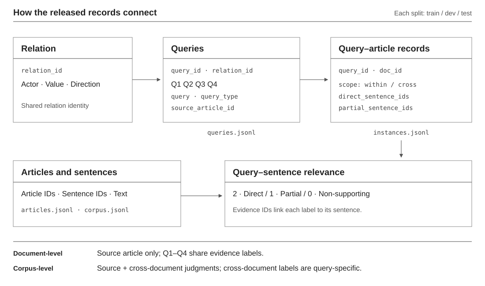

# HVER-News Dataset

Sentence evidence for actor-specific human values in news, organized into **document-level** and **corpus-level** ranking tasks.

[Data overview](#dataset-overview) · [Worked example](#a-real-dataset-example) · [Data files](#integrated-files) · [Detailed statistics](statistics/README.md)

## Dataset overview

Both tasks have train, dev, and test splits. Corpus-level includes the source article as well as other articles in the same split. Cross-document evidence is an extension of source-article evidence, not a separate third task.

*Arrows indicate record associations, not model stages. Sentence relevance is attached to a query–sentence pair.*

For the task illustration, see the [repository overview](../README.md#what-is-hver-news). An optional [interactive task diagram](overview/interactive.html) can be opened locally.

## A real dataset example

This example comes from the released **Test** split. Both articles concern **Extinction Rebellion activists**: the source article reports calls for stronger climate action, while the other article reports opposition to a rail project threatening ancient woodlands. Query text, sentence text, and labels are reproduced from the dataset.

**Relation:** Extinction Rebellion Activists and Supporters · Be protecting the environment · aligned

**Relation ID:** `rel_5469bdc553b732cf`

| Type | Query |
|---|---|
| Q1 | What evidence in the article supports that Extinction Rebellion Activists and Supporters is aligned with the human value "Be protecting the environment"? |
| Q2 | Where in the article do the demonstrations by environmental campaigners in London show an intention to be protecting the environment? |
| Q3 | Does the report provide details on how Extinction Rebellion activists justified their actions through ecological defense and climate advocacy? |
| Q4 | What evidence indicates that the individuals gathering in defiance of city restrictions were motivated by ecological concerns? |

The evidence labels below apply to **Q1**, `q_9fa2cde63f6105b9`. Only selected sentences are shown.

| Article | Sentence | Evidence label |
|---|---|---|
| Source article (A), `s4` | A number of demonstrations have been staged across the capital by the group, which is calling on the government to do more to tackle climate change. | **2 · Direct** |
| Source article (A), `s0` | Extinction Rebellion activists say they have left London's Trafalgar Square after police issued a ban on the group's climate change protests. | **1 · Partial** |
| Source article (A), `s1` | In a statement issued on Monday evening, the Metropolitan Police said demonstrators protesting in the capital after 21:00 BST could be arrested. | **0 · Non-supporting** |
| Other article (B), `s21` | Extinction Rebellion said HS2 would damage or destroy 108 ancient woodlands in the largest single act of deforestation in Britain since World War One. | **2 · Direct** |
| Other article (B), `s0` | LONDON (Reuters) - Climate change activists, including one of the founders of Extinction Rebellion, defied a police order to end protests on Tuesday after a week of disruption in London, targeting Britain’s transport ministry and security agency MI5. | **1 · Partial** |

- **Article A:** `0-4621-1-t`
- **Article B:** `0-4621-2-6`

Document-level ranking uses all sentences in article A. Corpus-level ranking also considers other articles in the same split, including B. Source-article labels are shared across Q1–Q4; the cross-document labels shown here belong to Q1 and should not be assumed to apply to all four queries.

Full IDs and the displayed records are available in [example.json](overview/example.json). The source files are [queries.jsonl](corpus-level/test/queries.jsonl), [instances.jsonl](corpus-level/test/instances.jsonl), and [corpus.jsonl](corpus-level/test/corpus.jsonl).

## Two views

- `corpus-level/{train,dev,test}`: six files per split for corpus-level evidence ranking. Source-article and cross-document judgments share query, article, and sentence IDs.
- `document-level/{train,dev,test}`: the exact view used by the document-level experiment loaders; this is not a cross-document export. Use its `qrels.tsv` with `avr_retriever_experiment`.

Labels, query text, evidence and qrels are preserved from the final datasets. Do not substitute the integrated instances into the document-level loader: their schemas differ.

## Integrated files

| File | Contents |
|---|---|
| `articles.jsonl` | Articles and their sentence lists |
| `corpus.jsonl` | Sentence retrieval units |
| `queries.jsonl` | Query text, formulation, relation and source article |
| `instances.jsonl` | Query–article judgments, sentence evidence, scope |
| `qrels.documents.tsv` | Query–article relevance |
| `qrels.sentences.tsv` | Query–sentence relevance |

Relevance grades: Direct=2, Partial=1, Non-supporting=0. Document Partial means no Direct evidence but at least one Partial sentence. Q1–Q4 share labels within the source article; cross-document labels are query-specific.

All source-article sentences are candidates, with sentences outside the Direct/Partial sets treated as non-supporting under the exhaustive document-level labeling contract. An absent cross-document qrel is **unjudged**, not a manually confirmed negative. The evaluator nevertheless assigns zero gain to an unjudged retrieved result and keeps its original rank.

## Test metadata

The public Test instances omit label-origin and review-tracking fields (`source`, `human_verified`, `provenance`, and `document_label_source`). Labels, evidence IDs and qrels are unchanged. This metadata omission does not alter annotation or review status.

`scope=within/cross` and `source_article_id` identify evidence location, not annotation origin, and remain available. The document-level loader retains its compatibility fields and `qrels.tsv`.

## Detailed evidence statistics

See [statistics/](statistics/README.md) for Direct, Partial and Non-supporting query–sentence counts by query type, split, and document-level/cross-document-only/corpus-level scope. The summary tables and CSV results are included.
